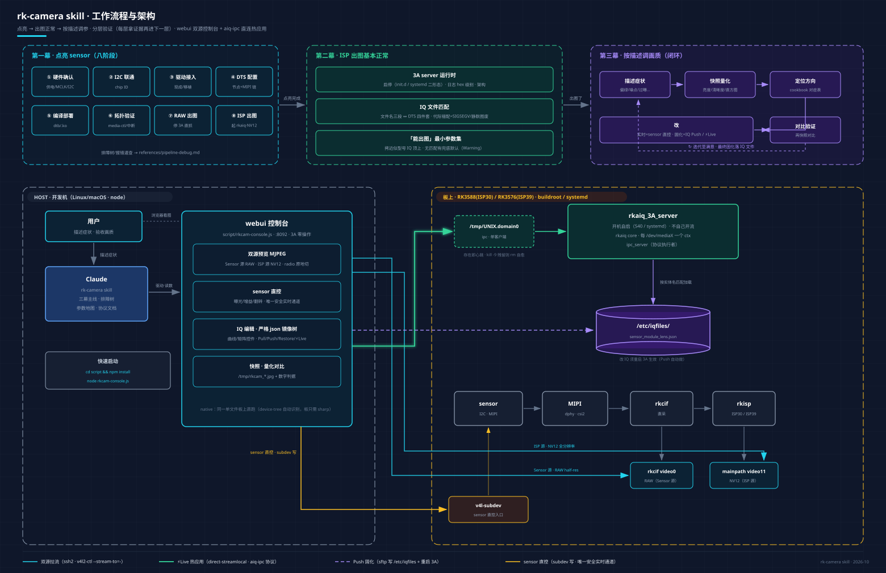
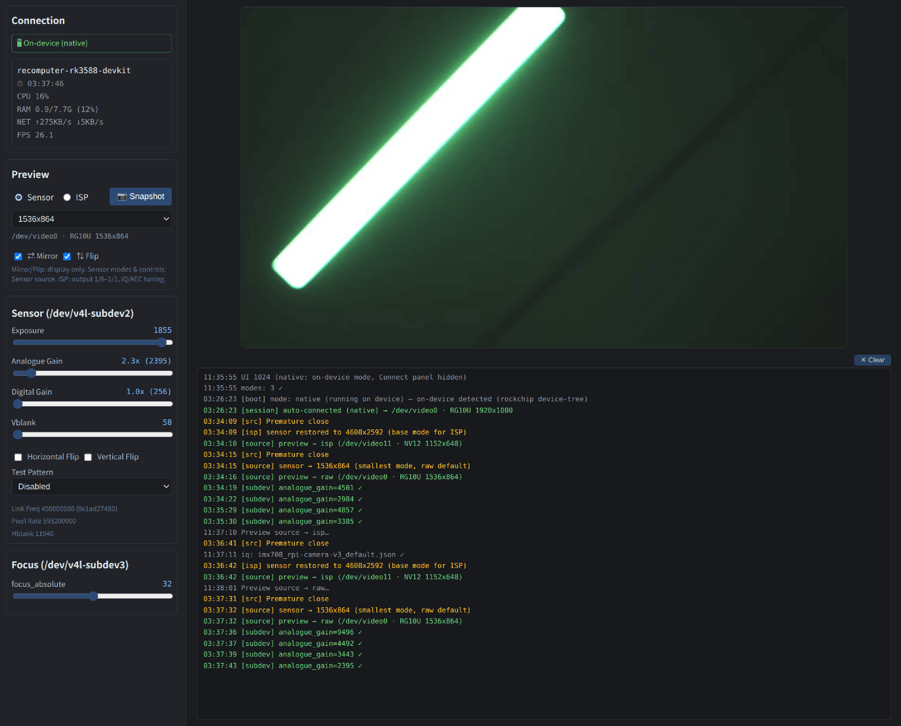
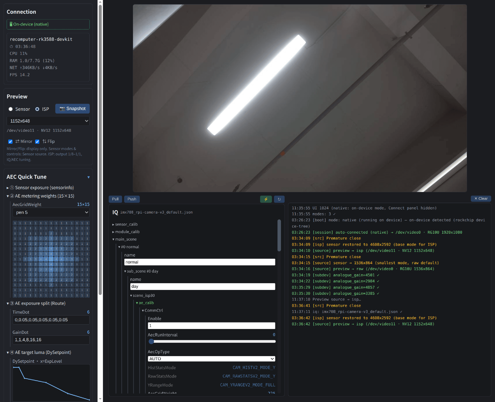

# rk-camera — Rockchip camera skill（点亮 → 出图正常 → 调优）

Claude skill：拿一颗新 sensor，从硬件上电到稳定出图、再到**按症状描述调画质**的全流程知识 + 自带 web 预览控制台。

v0.1.0（2026-10-18）· MIT License（见 [LICENSE](LICENSE)）· [English](README.md)

## 它能做什么

- **第一幕·点亮 sensor**：供电/I2C 检查 → 驱动移植 → DTS 配置 → media pipeline 验证 → RAW 出图。分层验证方法论（每层拿到确凿证据再进下一层）+ 完整排障树。
- **第二幕·ISP 出图基本正常**：rkaiq/3A server 运行时（启停/日志/架构）、IQ 文件匹配与部署、"能出图"最小参数集与换 sensor 移植清单。
- **第三幕·按描述调画质**：你描述症状（"画面偏绿 / 夜间噪点多 / 过曝"），Claude 走 **量化快照 → 症状→参数方向 → 控制台改 IQ → 对比验证** 的闭环。
- 深水区按需下钻：调参协议（unix 直连）逆向文档、rkaiq 架构源码级说明、rkaiq 重编指引、官方文档地图。



## 环境要求

| 端 | 要求 |
|---|---|
| host | Linux / macOS + node ≥ 16 + npm；`~/.ssh/config` 里有目标板的免密别名 |
| 板 | Rockchip Linux SDK 镜像（buildroot 或 systemd 均可），ssh 可达 |
| 控制台 | `script/` 下 `npm install`（sharp 为原生二进制，需联网；离线环境提前在有网机器装好再拷贝） |

**支持芯片**：RK3588 / RK3576 / RK3572 / RV1106 / RV1103B。

板卡 ssh 别名示例（`~/.ssh/config`，skill 文档统一用 `<别名>` 占位）：

```
Host rk3588
    HostName 192.168.x.x        # 板子 IP（建议在路由器绑静态租约）
    User root
    # Port 22 / ProxyJump 跳板 / IdentityFile 密钥 按需
```

## 安装

```bash
# 方式一：整目录拷入
cp -r rk-camera ~/.claude/skills/

# 方式二：clone 仓库后 symlink（便于随仓库更新）
ln -sfn /path/to/rk-camera ~/.claude/skills/rk-camera
```

## 3 分钟上手

1. 起控制台：

   ```bash
   cd rk-camera/script && npm install    # 首次
   node rkcam-console.js              # 浏览器 http://localhost:8092，面板选板连接
   ```

   也可把单文件拷到**板上原生运行**（自动识别 rockchip device-tree → 免 host ssh，板上只需 `npm i sharp`）。

2. 对 Claude 说（用法示例见下节）。
3. Claude 按 skill 三幕主线推进，用控制台快照做量化对比，最终改动固化到板上 IQ 文件。

### 控制台长这样

双源同一面板 radio 原地切换（不重建会话）：

**Sensor 源**——rkcif RAW 直解预览 + sensor/VCM 直控（曝光/增益/Vblank/测试图案滑杆直写 subdev）；底部 AEC 快速调试五步面板与 log 窗：



**ISP 源**——mainpath NV12 直解预览 + IQ 编辑工作台：严格 json 结构镜像树全模块可编辑，**绿色组头 = 可热更新模块**，开 ⚡Live 后修改即时热应用到引擎（log 逐条 `old → new`），满意后 Push 固化到板上 IQ 文件：



## 用法示例

对 Claude 自然语言描述，skill 决定推进路径——四类典型场景：

| 场景 | 你对 Claude 说 | Claude 会做什么（skill 指引的行为） |
|---|---|---|
| **点亮新 sensor** | “在 rk3588 板上点亮 os04c10” | 按八阶段推进：先查 `$SDK` 有无现成驱动 → 核 DTS 四件套 → 单编 dtb 推板 → `media-ctl` 验证拓扑与帧中断 → 停 3A 抓 RAW 确认数据 → 起 3A 出 NV12；中途报错（probe 失败/无中断/花屏）自动走进排障树逐层定位 |
| **出图不正常** | “rkaiq 在跑，但画面偏绿” | `ls /tmp/UNIX.domain*` 查 3A 心跳 → 日志回溯 IQ 匹配行 → 发现匹配失败在用默认参数 → 按文件名三段式对照 DTS → 从 SDK 找近似型号 IQ 推板重启 → 验证加载日志 |
| **按症状调画质** | “夜间噪点太多” | 控制台快照量化（亮度/清晰度）→ 调参手册对症定位 3DNR 模块 → IQ 编辑器改低照 ISO 档降噪参数 → ⚡Live 热应用实时预览 → 满意后 Push 固化（写板文件 + 自动重启 3A 生效） |
| **换 sensor 移植 IQ** | “sensor 换了，IQ 文件怎么弄” | 判定 ISP 代际选 `ispXX` 目录 → 没有现成文件时给搜索源与相似型号排序 → 部署重启验证；跨代迁移则走 `sensor_calib` 平移 + 目标平台模板重建（不手工改名跨代用） |

排障、深查类问题（“3A server 起不来”“协议封包怎么打”“某个参数什么语义”）也直接问——skill 的 13 篇 references 覆盖排障树、协议逆向文档、参数地图与官方文档索引。

## 目录

```
SKILL.md       Claude 读的主线（三幕 + 全部 reference 索引）
references/    13 篇：点亮侧 / 运行时侧 / 调参侧 + 协议·架构·重编深水区
script/        web 控制台发布位：rkcam-console.js 单文件（esbuild，html+schema 内嵌）
               + package.json（sharp/ssh2 消费者依赖）
img/           README 用图：架构图 diagram + 控制台双源实拍 raw / isp
```
